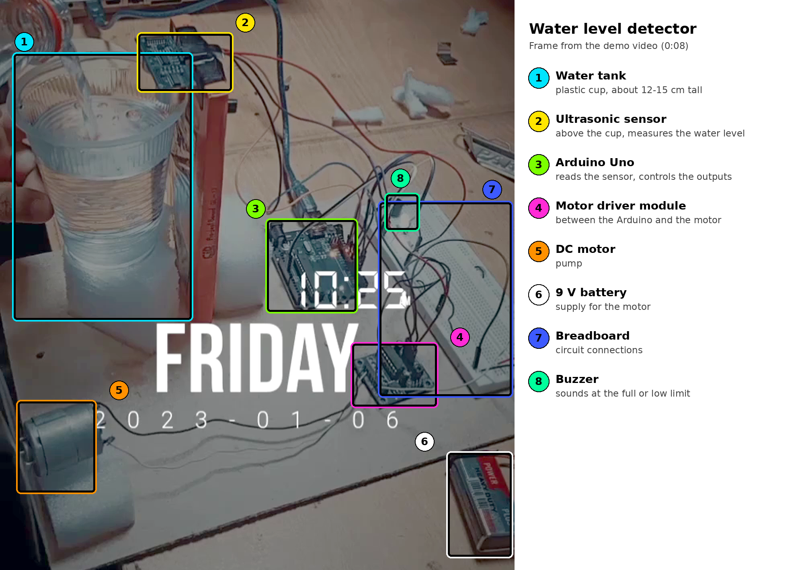

# Smart Water Level Detector and Controller (Ultrasonic Sensor + Arduino Uno)

**Instrumentation and Measurement Lab · Institute of Space Technology, Islamabad**

An ultrasonic water level measurement and control system. An ultrasonic sensor mounted above a tank measures the distance to the water surface, an Arduino Uno converts that distance into a water level, and a pump motor is switched on and off through a motor driver. A buzzer sounds when a limit is reached. The prototype used a plastic cup about 12 to 15 cm tall as the tank.

The system works in two modes:

- **Fill mode:** the pump moves water *into* the tank. When the water reaches the full threshold, the motor stops because the tank needs no more water, and the buzzer sounds.
- **Drain mode:** the pump moves water *out of* the tank. When the water drops into the red zone, the motor stops and the buzzer warns of a water shortage, so the tank needs to be refilled.

> **About the code.** The hardware demonstration was built and recorded in January 2023, during the Fall 2022 semester. The pin assignment and distance thresholds are the ones used in this repository, so check them against your own wiring and container.

---

## Demonstration



*Frame from the demo video: the ultrasonic sensor above the cup, the Arduino Uno, the motor driver and the motor. In the video, the buzzer sounds when the water poured into the cup passes the threshold.*

---

## How it works

```
Ultrasonic sensor  →  Arduino Uno  →  Motor driver  →  DC motor (pump)
measures distance     computes the     switches the      moves water in
to the water          water level      motor supply      or out of the tank
                          │
                          └──────────→  Buzzer (alarm at a limit)
```

1. The Arduino sends a short trigger pulse to the ultrasonic sensor.
2. The sensor sends out a burst of ultrasound, and the Arduino times how long the echo takes to return from the water surface.
3. The echo time is converted to a distance, and the median of several readings is used to reject noise from ripples.
4. The distance is converted to a water level percentage and compared with the thresholds for the selected mode.
5. The motor is switched through the driver module, the buzzer is turned on or off, and the readings are printed over the serial port.

---

## How the ultrasonic sensor measures distance

The sensor has a transmitter and a receiver (the two "eyes" of the module). The transmitter sends a burst of ultrasound (about 40 kHz) towards the water. The sound reflects off the surface and returns to the receiver, and the time between sending and receiving is the **echo time**.

Because the sound travels to the surface and back, the distance is half of the total path:

```
distance = (echo time × speed of sound) / 2
```

With the speed of sound at about 343 m/s (0.0343 cm/µs) at room temperature, an echo time of 700 µs gives `700 × 0.0343 / 2 ≈ 12 cm`.

As the tank fills, the water surface moves closer to the sensor and the echo time gets shorter, so a smaller distance means a higher water level.

---

## Control logic

Each mode uses two thresholds, so the motor does not switch on and off repeatedly when the surface ripples around a single limit. The distances below are the sensor-to-water distances used in this repository for a cup 12 to 15 cm tall.

**Fill mode (pump moves water into the tank)**

| Water surface distance | Meaning | Motor | Buzzer |
|---|---|---|---|
| 3 cm or less | Tank is full | OFF | ON |
| 6 cm or more (level has dropped) | Tank needs water | ON | OFF |
| Between 3 cm and 6 cm | Normal range | Keeps its last state | Keeps its last state |

**Drain mode (pump moves water out of the tank)**

| Water surface distance | Meaning | Motor | Buzzer |
|---|---|---|---|
| 10 cm or more | Red zone, water shortage | OFF | ON |
| 7 cm or less (tank refilled) | Enough water | ON | OFF |
| Between 7 cm and 10 cm | Normal range | Keeps its last state | Keeps its last state |

The empty-tank distance is set to 13 cm, which gives the 0 to 100 % level shown on the serial monitor. All of these values are constants at the top of the sketch, and the mode is chosen with one setting, `OPERATING_MODE`.

If the sensor gets no valid echo several times in a row, the motor is switched off as a safety measure.

---

## Concepts demonstrated

| Concept | Where it appears |
|---|---|
| Ultrasonic time-of-flight ranging | Distance calculated from the echo time and the speed of sound |
| Level measurement by non-contact sensing | The sensor measures the water surface without touching the water |
| Signal conditioning in software | Median of several readings removes outliers from ripples and stray echoes |
| Calibration and scaling | Distance mapped to a 0 to 100 % level using the empty and full distances |
| On-off control with hysteresis | Two thresholds in each mode prevent rapid switching of the motor |
| Actuator driving | A motor driver lets the Arduino control a motor on a separate supply |
| Alarm indication | A buzzer signals a full tank or a water shortage |
| Fault handling | The motor stops after repeated failed readings |

---

## Components

| Component | Notes |
|---|---|
| Arduino Uno | Controller, powered over USB |
| Ultrasonic sensor (HC-SR04) | Measures distance to the water surface |
| Motor driver module | Switches the motor from the Arduino's control signals |
| DC motor | Acts as the pump |
| Buzzer | Alarm at the full or low limit |
| 9 V battery | Separate supply for the motor |
| Plastic cup | Tank, about 12 to 15 cm tall |
| Breadboard and jumper wires | Prototype assembly |

---

## Wiring

| Connection | Arduino pin |
|---|---|
| Sensor TRIG | D9 |
| Sensor ECHO | D10 |
| Motor driver IN1 | D7 |
| Motor driver IN2 | D8 |
| Motor driver enable | D5 (PWM) |
| Buzzer (active) | D4 |
| Sensor supply | 5 V and GND |

The motor is powered from the 9 V battery through the driver. **Connect the battery's ground to the Arduino's ground**, so the control signals share a common reference.

---

## Running the code

1. Open `smart_water_level_detector/smart_water_level_detector.ino` in the Arduino IDE.
2. Choose the mode at the top of the sketch: `FILL_TANK` or `DRAIN_TANK`.
3. Select **Arduino Uno** and the correct port, then upload.
4. Open the serial monitor at 9600 baud. It prints lines in this format: `Distance: 11.8 cm | Level: 12 % | Motor: ON | Buzzer: OFF`
5. Measure the distance from the sensor to the bottom of your empty tank and set `EMPTY_DISTANCE_CM`. Set `FULL_DISTANCE_CM` and `LOW_DISTANCE_CM` for the levels you want.

---

## Limitations and possible improvements

- **Short range.** The sensor cannot measure objects closer than about 2 cm, so keep the full level beyond that.
- **Temperature.** The speed of sound changes with temperature, which slightly changes the distance. A temperature sensor could correct it.
- **Surface conditions.** Ripples, foam and splashing water can scatter the echo, which the median filter reduces but does not remove.
- **Narrow tanks.** In a narrow cup the sound can reflect off the walls, so the sensor should be centred above the opening.
- **Possible upgrades.** Add an LCD or LEDs for the level, a selector switch for the mode, or a relay to drive a mains pump.

---

## Repository contents

```
smart-water-level-detector/
├── README.md
├── smart_water_level_detector/
│   └── smart_water_level_detector.ino
└── images/
    └── hardware_annotated.png
```
